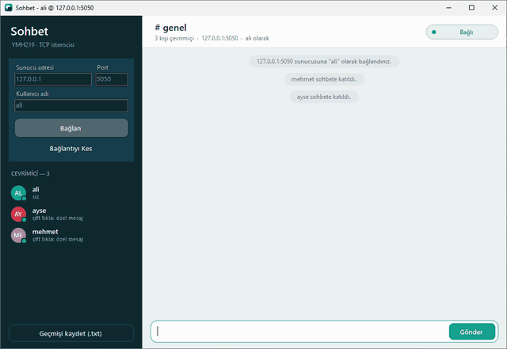
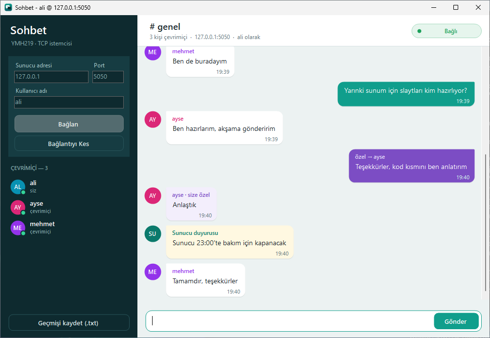
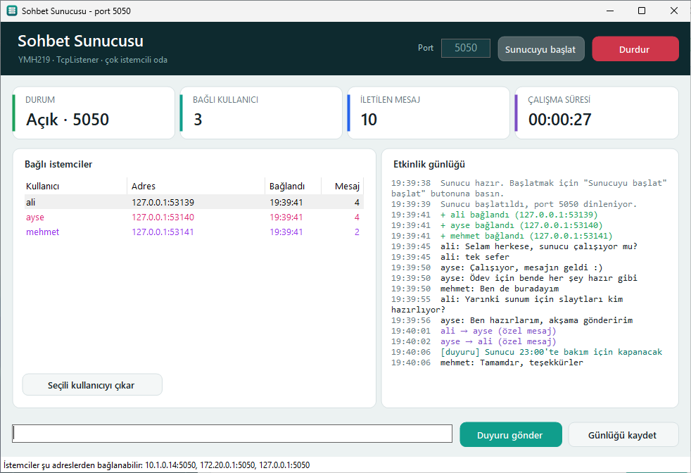
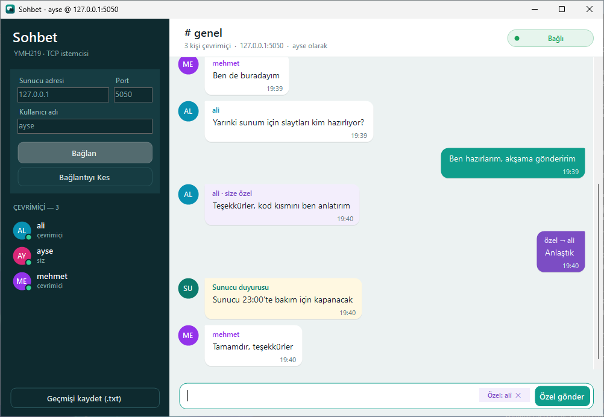
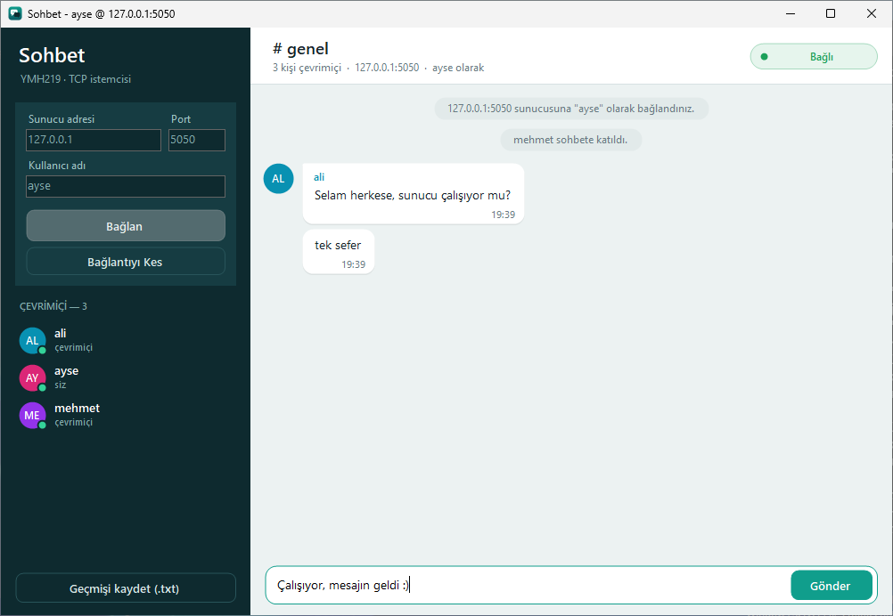
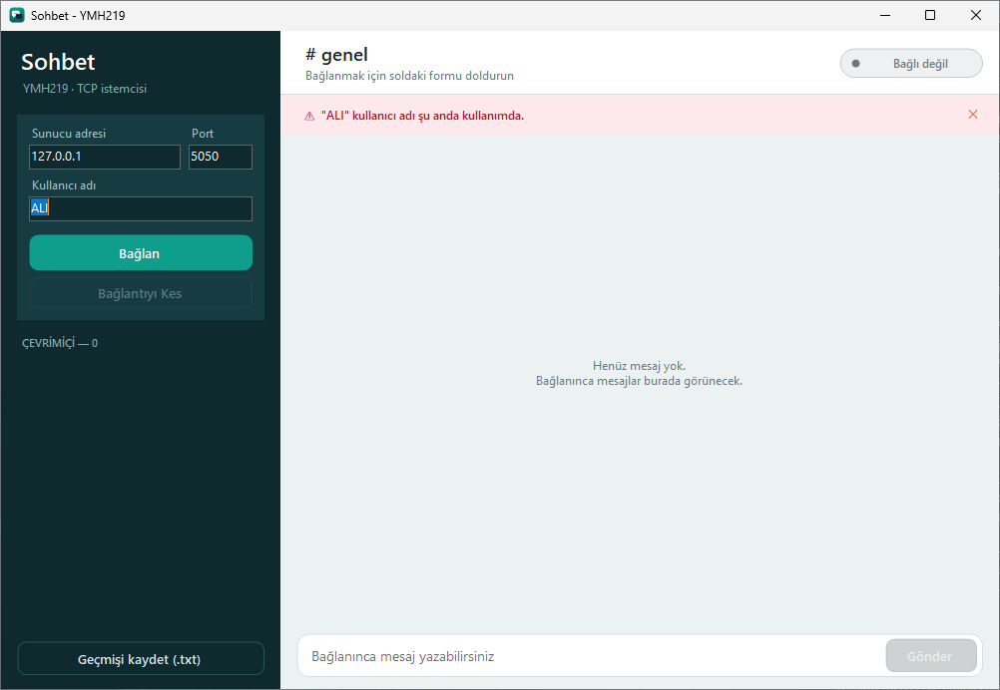
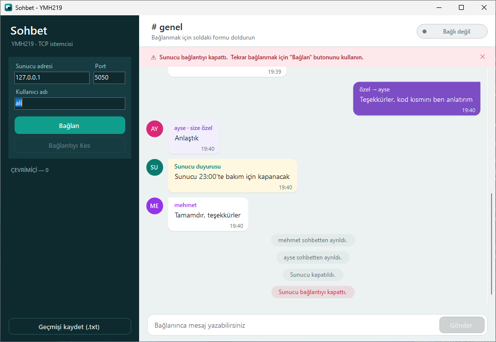
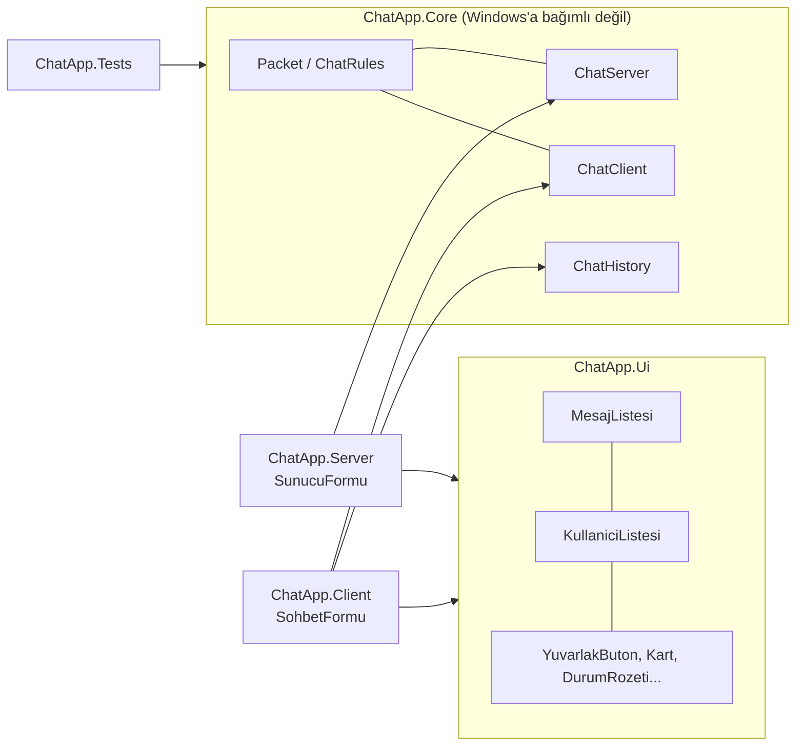
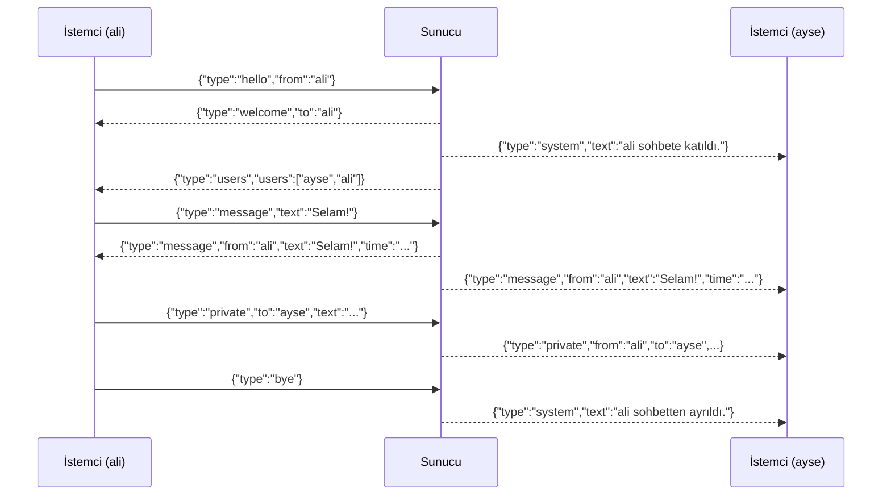

# YMH219-ChatApp · İstemci–Sunucu Sohbet Uygulaması

[](https://github.com/ozenyunus35/YMH219-ChatApp/actions/workflows/dotnet.yml)

YMH219 Nesne Tabanlı Programlama dersi için yazılmış, **TcpListener / TcpClient** tabanlı çok kullanıcılı sohbet uygulaması.
Bir **sunucu** ve istediğiniz kadar **istemci** aynı bilgisayarda ya da aynı yerel ağda çalışabilir.



---

## İçindekiler

- [Özellikler](#özellikler)
- [Ekran görüntüleri](#ekran-görüntüleri)
- [Kurulum ve çalıştırma](#kurulum-ve-çalıştırma)
- [Mimari](#mimari)
- [Mesaj protokolü](#mesaj-protokolü)
- [Testler](#testler)
- [Bilinen sınırlamalar](#bilinen-sınırlamalar)

## Özellikler

**Ödevde istenenler**

- [x] Aynı bilgisayarda veya yerel ağda çalışan sunucu ve birden fazla istemci
- [x] İstemci kullanıcı adı ile bağlanıyor (aynı ad ikinci kez kullanılamıyor)
- [x] Gönderilen ve alınan mesajlar **saatiyle** birlikte gösteriliyor (saati sunucu belirliyor)
- [x] **Bağlan**, **Gönder** ve **Bağlantıyı Kes** işlevleri
- [x] Bağlantı hataları uygulamayı kapatmıyor; üstte anlaşılır bir uyarı şeridinde gösteriliyor
  (sunucu kapalı, port dolu, ad alınmış, bağlantı koptu, sunucudan atıldınız...)
- [x] Sunucuda bağlı istemcilerin listesi: kullanıcı adı, IP:port, bağlanma saati, mesaj sayısı

**İsteğe bağlı olanlar**

- [x] Birden fazla istemci aynı odada (`# genel`)
- [x] Özel mesaj: kullanıcı listesinde çift tıklama **veya** `/w kullanıcı mesaj` komutu
- [x] Mesaj geçmişini `.txt` dosyasına kaydetme (istemci) ve sunucu günlüğünü kaydetme

**Ekstralar**

- "ayse yazıyor..." göstergesi
- Katıldı / ayrıldı bildirimleri, çevrimiçi kullanıcı listesi (avatarlı)
- Sunucudan tüm kullanıcılara **duyuru** ve kullanıcıyı **çıkarma**
- Sunucu ekranında anlık istatistikler (bağlı kullanıcı, iletilen mesaj, çalışma süresi)
- Sunucu, özel mesajların **içeriğini göstermiyor**; sadece kimden kime gittiğini yazıyor
- Mesaj balonları: kendi mesajlarınız sağda, özel mesajlar mor, sunucu duyuruları sarı

### Kullanım ipuçları

| Nerede | Ne yapar |
|---|---|
| Sunucu / port / kullanıcı adı kutusunda `Enter` | Bağlanır |
| Mesaj kutusunda `Enter` | Gönderir (aynı mesaj iki kez gitmez) |
| Kullanıcı listesinde çift tık, `Enter` veya sağ tık → *Özel mesaj gönder* | Özel moda geçer; `Esc` veya çipteki ✕ genel sohbete döner |
| Mesaj balonuna sağ tık | Mesajı ya da tüm sohbeti panoya kopyalar |
| Sunucuda tabloda `Delete` | Seçili kullanıcıyı (onay sorarak) çıkarır |
| Sunucuda port kutusunda `Enter` | Sunucuyu başlatır |

Bağlı kullanıcı varken sunucuyu durdurmak veya pencereyi kapatmak önce onay ister.

## Ekran görüntüleri

| İstemci (ali) | Sunucu |
|:-:|:-:|
|  |  |

| Diğer istemci (ayse) · özel mesaj modu | "yazıyor..." göstergesi |
|:-:|:-:|
|  |  |

| Aynı kullanıcı adı hatası | Sunucu kapanınca |
|:-:|:-:|
|  |  |

## Kurulum ve çalıştırma

**Gereksinim:** Windows 10/11 ve .NET 10 SDK (veya Visual Studio 2026). Harici NuGet paketi yok.

### Visual Studio ile

1. `YMH219-ChatApp.sln` dosyasını açın.
2. Solution'a sağ tıklayın → **Configure Startup Projects...** → **Multiple startup projects**
   → `ChatApp.Server` ve `ChatApp.Client` için **Start** seçin.
3. <kbd>F5</kbd>. Sunucu penceresinde **Sunucuyu başlat**'a basın, istemcide bir ad yazıp **Bağlan**'a basın.
4. İkinci bir istemci için: `ChatApp.Client` projesine sağ tık → **Debug → Start New Instance**.

### Komut satırı ile

```bash
dotnet build
dotnet run --project ChatApp.Server
dotnet run --project ChatApp.Client -- ali
dotnet run --project ChatApp.Client -- ayse
```

İstemciye isteğe bağlı olarak `[kullanıcı] [sunucu] [port]` verilebilir; form bu değerlerle dolu açılır.

### Yerel ağda (iki farklı bilgisayar)

Sunucu ekranının altında bilgisayarın IP adresleri yazıyor (ör. `192.168.1.5:5050`).
Diğer bilgisayardaki istemcide **Sunucu adresi** kısmına bu IP'yi yazın.
İlk çalıştırmada Windows Güvenlik Duvarı izin isteyebilir: **Özel ağlar** için izin verin.

## Mimari



| Proje | Görevi |
|---|---|
| `ChatApp.Core` | Protokol, sunucu ve istemci mantığı. WinForms'a bağlı değil, bu yüzden testlerle doğrudan denenebiliyor |
| `ChatApp.Ui` | İki uygulamanın ortak kullandığı özel çizilmiş kontroller |
| `ChatApp.Server` | Sunucu penceresi |
| `ChatApp.Client` | İstemci penceresi |
| `ChatApp.Tests` | xUnit testleri |

**Thread konusu:** Ağ okuma döngüleri arka planda (`Task.Run` + `async/await`) çalışıyor. WinForms kontrolleri sadece UI thread'inden
güncellenebildiği için `ChatServer` ve `ChatClient`, oluşturuldukları andaki `SynchronizationContext`'i yakalayıp olayları
(`PacketReceived`, `ClientConnected`...) UI thread'ine aktarıyor. Formlarda `Invoke` yazmaya gerek kalmıyor.

## Mesaj protokolü

Her paket **tek satırlık JSON** olarak gönderiliyor (`StreamWriter.WriteLine` / `StreamReader.ReadLine`).
Mesaj içindeki satır sonları JSON'da `\n` olarak kaçışlandığı için satır bazlı okuma bozulmuyor.



Paket türleri: `hello`, `welcome`, `message`, `private`, `users`, `system`, `typing`, `error`, `bye`.
Gönderen adı ve saat **sunucuda** belirleniyor; istemcinin gönderdiği değere güvenilmiyor.

## Testler

`ChatApp.Tests` içinde **46 test** var. Testler sunucuyu `localhost` üzerinde boş bir portta gerçekten başlatıp
gerçek `TcpClient` bağlantılarıyla deniyor:

- mesajın herkese, sunucu saatiyle ulaşması · özel mesajın **sadece** alıcıya gitmesi
- aynı / geçersiz kullanıcı adının reddedilmesi · olmayan kullanıcıya özel mesaj
- katılma / ayrılma bildirimleri ve kullanıcı listesinin güncellenmesi · "yazıyor" bilgisinin sadece diğerlerine gitmesi
- sunucu kapanınca istemcinin çökmeden durumu fark etmesi · kapalı porta bağlanınca anlaşılır hata
- kullanıcı çıkarma · sunucuya bozuk veri gönderilince sunucunun çalışmaya devam etmesi · dolu port
- protokolün JSON'a çevrilip geri okunması, kurallar, `/w` komutu, geçmişin dosyaya yazılması

```bash
dotnet test
```

GitHub Actions her push'ta projeyi Windows'ta derleyip testleri çalıştırıyor (üstteki rozet).

## Bilinen sınırlamalar

- Tek oda var (`# genel`); birden fazla oda yok.
- Mesajlar şifrelenmeden gönderiliyor; ders kapsamında yerel ağ kullanımı için tasarlandı.
- Mesaj geçmişi sunucuda saklanmıyor; sonradan bağlanan kullanıcı eski mesajları görmüyor.
- Windows Forms kullanıldığı için uygulamalar yalnızca Windows'ta çalışır (`ChatApp.Core` ise platformdan bağımsız).

## Öğrenci

**Yunus Emre Özen** · 215542001 · YMH219 Nesne Tabanlı Programlama
